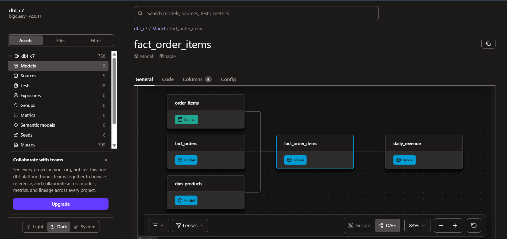

# StyleHub dbt — Session 7 Homework (`dbt_c7`)

## 0. Đầu vào cần có

Verify connection and materialize Silver models (`dim_products`, `dim_users`, `fact_orders`, `fact_shipments`, `fact_order_items`):

```bash
dbt debug
dbt run --select dim_products dim_users fact_orders fact_shipments fact_order_items
```

## 1. Bảng Gold đầu tiên

Materialize `models/gold/daily_revenue.sql` (`order_date`, `total_orders`, `revenue`, `total_cost` from `{{ ref('fact_order_items') }}`, excluding `Cancelled` and `Returned` orders):

```bash
dbt run --select daily_revenue
```

## 2.  Câu kiểm tra trong analyses

Compile discrepancy check (`amount != sale_price * quantity` on `{{ ref('fact_order_items') }}`):

```bash
dbt compile --select check_amount
```

- **Compiled SQL:** `target/compiled/dbt_c7/analyses/check_amount.sql`
- **BigQuery Result:** `0 rows` (`amount` matches `sale_price * quantity` across all records).

## 3. Lineage & Git

Generate and serve project documentation & DAG lineage:

```bash
dbt docs generate
dbt docs serve
```

### Lineage Graph (`daily_revenue`)


